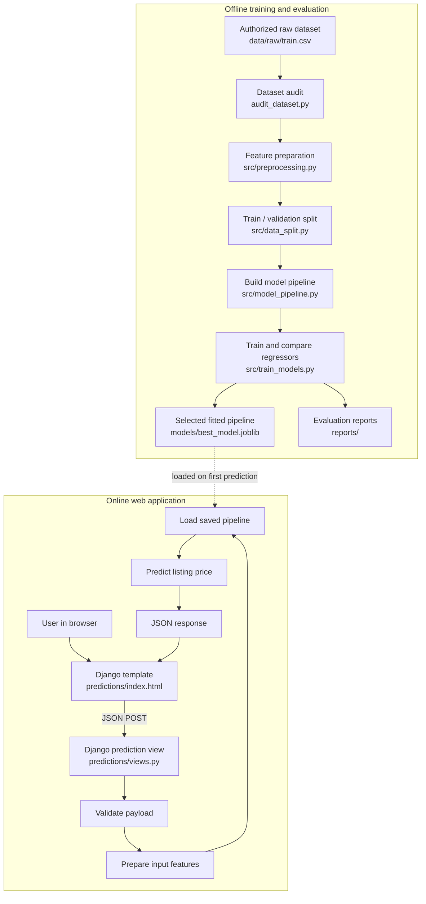
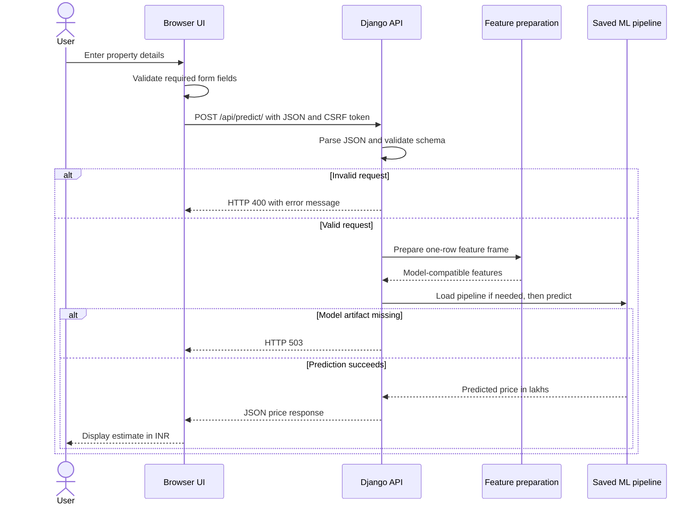

# EstateIQ — Real Estate Property Price Estimator

**EstateIQ** is a machine-learning web application that estimates residential property listing prices from property characteristics and location-related inputs. It combines a Django web application, a browser-based estimator, and a scikit-learn training pipeline.

> **Project status:** Educational / portfolio project. A prediction is a model estimate based on the training data, not a certified valuation, a guarantee of a sale price, or financial advice.

## Contents

- [Overview](#overview)
- [Features](#features)
- [Technology stack](#technology-stack)
- [System architecture](#system-architecture)
- [Prediction request lifecycle](#prediction-request-lifecycle)
- [Repository structure](#repository-structure)
- [Dataset](#dataset)
- [Machine-learning workflow](#machine-learning-workflow)
- [Installation and local setup](#installation-and-local-setup)
- [Run the application](#run-the-application)
- [API reference](#api-reference)
- [Generated model reports](#generated-model-reports)
- [Testing and quality checks](#testing-and-quality-checks)
- [Configuration and security](#configuration-and-security)
- [Known limitations](#known-limitations)
- [Roadmap](#roadmap)
- [Contributing](#contributing)

## Overview

The goal of this project is to demonstrate an end-to-end applied machine-learning workflow:

1. Inspect and audit a property-listing dataset.
2. Prepare raw columns for model training.
3. Split the data into training and validation subsets.
4. Train and compare multiple regression algorithms.
5. Save the selected preprocessing-and-model pipeline.
6. Serve predictions through a Django JSON endpoint.
7. Let users enter property details through a responsive browser interface.
8. Generate evaluation reports to help inspect model quality.

The app currently accepts information such as listing poster, property type, BHK/RK count, area, address, coordinate fields, construction status, RERA registration, move-in readiness, and resale status.

## Features

### Web application
- Responsive EstateIQ estimator interface built with HTML, Tailwind CSS CDN, custom CSS, and vanilla JavaScript.
- Property input form grouped into basics, location, and construction/ownership sections.
- Client-side browser validation and server-side request validation.
- Loading, success, and error states for prediction requests.
- Displays the estimate in Indian rupees and lakhs.
- Django CSRF protection for browser POST requests.

### Machine learning
- Preprocessing utilities and a reusable model pipeline.
- Compares Linear Regression, Random Forest Regressor, and XGBoost Regressor.
- Selects the candidate model according to validation MAE in the training script.
- Saves the selected pipeline as `models/best_model.joblib`.
- Produces comparison, price-segment, validation-error, metrics, and model-card reports when training runs successfully.

### Reliability and maintenance
- Environment-based Django settings using `.env` for local development.
- Lazy loading of the trained model so Django can start even when the model artifact is missing.
- A health endpoint that reports whether the model artifact is present.
- Unit tests for key API behavior.
- Django test coverage for key API behavior; run checks and tests locally before merging.

## Technology stack

| Layer | Technologies | Responsibility |
|---|---|---|
| User interface | HTML, CSS, Tailwind CSS CDN, vanilla JavaScript | Render the form, validate basic input, call the API, and show the result |
| Web framework | Python, Django | Serve the page, route requests, validate API payloads, and return JSON |
| Data handling | Pandas, NumPy | Build tabular input and support data preparation |
| Machine learning | scikit-learn, XGBoost | Preprocess features, train regressors, evaluate candidates, and predict prices |
| Model persistence | Joblib | Save and load the fitted model pipeline |
| Exploration | Jupyter, Matplotlib, Seaborn | Exploratory data analysis and visualization |
| Quality checks | Django tests, GitHub Actions | Run application checks and automated tests |

The current interface is rendered by Django templates. The `frontend/` directory is not a separate React application in the current runtime path.

## System architecture

The system has two main flows: **offline model training** and **online prediction**. Training happens before the application serves estimates; the web request uses the saved pipeline rather than retraining a model for each user.



### Architecture responsibilities

- **Browser/template:** collects user inputs, performs basic HTML validation, sends JSON to Django, and formats the returned price. It does not train the ML model.
- **Django URL configuration:** maps browser and API paths to their corresponding views.
- **Prediction view:** parses JSON, validates required fields and value ranges, prepares a one-row input frame, loads the trained pipeline, and returns a JSON response.
- **Preprocessing module:** transforms raw feature columns into the representation expected by the fitted pipeline. Training and inference must use compatible preprocessing.
- **Training pipeline:** splits the dataset, fits candidate regressors, evaluates validation predictions, chooses a candidate according to the configured metric, and persists the fitted pipeline.
- **Reports:** store model-comparison and diagnostic information for inspection; they are generated during training, not during normal prediction requests.

## Prediction request lifecycle



### Important design decision: save the complete pipeline

The saved artifact should contain the fitted preprocessing and estimator steps together. This reduces the risk of applying one transformation during training and a different transformation during prediction. Only load trusted Joblib artifacts created with compatible Python and library versions: loading a pickle-based artifact from an untrusted source can execute code.

## Repository structure

```text
real-estate-property-price-estimator/
├── backend/
│   ├── manage.py                 # Django management entry point
│   └── config/
│       ├── settings.py           # Django settings and environment config
│       ├── urls.py               # Root URL routing
│       ├── asgi.py               # ASGI application entry point
│       └── wsgi.py               # WSGI application entry point
├── data/
│   └── README.md                 # Dataset instructions; raw data is not committed
├── docs/
│   └── benchmark-and-implementation.md
├── models/
│   └── .gitkeep                  # Model artifacts are generated locally and ignored
├── notebooks/
│   └── real_estate_price_estimator.ipynb
├── predictions/
│   ├── tests.py                  # API and view tests
│   ├── urls.py                   # Prediction app routes
│   ├── views.py                  # Home, health, and prediction views
│   └── templates/
│       └── predictions/
│           └── index.html        # EstateIQ browser UI
├── reports/                      # Generated model evaluation reports
├── src/
│   ├── data_split.py             # Train/validation split
│   ├── model_pipeline.py         # Preprocessing/model pipeline builder
│   ├── preprocessing.py          # Feature preparation
│   └── train_models.py           # Train, compare, and report on regressors
├── audit_dataset.py              # Raw dataset quality audit
├── .env.example                  # Example local configuration
├── .gitignore
├── requirements.txt
└── README.md
```

Some directories or artifacts (such as `data/raw/`, `reports/`, and the fitted model) may only appear after local setup or training. Raw data, secrets, and trained binary artifacts are intentionally not tracked by Git.

## Dataset

The training script expects an authorized dataset at:

```text
data/raw/train.csv
```

The target column is `TARGET(PRICE_IN_LACS)`, representing the listed target price in lakhs. The dataset fields used by the project are:

| Dataset column | Meaning in the application |
|---|---|
| `POSTED_BY` | Listing poster category, such as Owner, Dealer, or Builder |
| `UNDER_CONSTRUCTION` | Whether the property is under construction |
| `RERA` | RERA registration flag |
| `BHK_NO.` | BHK/RK count |
| `BHK_OR_RK` | Property configuration category |
| `SQUARE_FT` | Area in square feet |
| `READY_TO_MOVE` | Whether the property is ready to move into |
| `RESALE` | Whether the property is a resale listing |
| `ADDRESS` | Address/locality text |
| `LONGITUDE`, `LATITUDE` | Coordinate fields supplied by the dataset |
| `TARGET(PRICE_IN_LACS)` | Target value used during training |

The project notebook records 29,451 training rows and 68,720 test rows for the dataset version previously used. Re-check these counts when obtaining a new copy of the data.

**Data licensing:** obtain the dataset from an authorized source, read its license and terms, and do not commit raw listing data unless redistribution is explicitly permitted.

## Machine-learning workflow

1. **Audit the data.** Run the audit script to inspect columns and data quality issues.
2. **Prepare features.** Normalize feature types and derive the additional features implemented in `src/preprocessing.py`.
3. **Split the data.** Use the configured training/validation split. Keep validation data out of model fitting.
4. **Build preprocessing.** The pipeline handles numeric and categorical features so the fitted transformation can be reused at inference.
5. **Train candidates.** The current candidates are Linear Regression, Random Forest, and XGBoost.
6. **Evaluate.** Compare candidates using MAE, RMSE, and R². MAE is the selection metric in the training script; RMSE is especially sensitive to large errors.
7. **Persist the winner.** The selected fitted pipeline is saved as `models/best_model.joblib`.
8. **Inspect reports.** Use the price-segment report and validation error report to look for uneven performance and extreme errors.

### Evaluation metrics

- **MAE (Mean Absolute Error):** average absolute difference between predicted and actual prices. Lower is better; its unit is lakhs here.
- **RMSE (Root Mean Squared Error):** penalizes large errors more strongly than MAE. Lower is better.
- **R²:** compares the model with a mean-target baseline. A value closer to 1 is generally better; negative values indicate performance worse than that baseline on the evaluated data.

### Historical local validation results

These values are historical results from a previous local run. Re-run training on the exact dataset before using them as current benchmarks.

| Model | MAE (lakhs) | RMSE (lakhs) | R² |
|---|---:|---:|---:|
| Linear Regression | 1,362.60 | 58,414.74 | -6,261.59 |
| Random Forest | 37.82 | 394.24 | 0.7148 |
| XGBoost | 42.74 | 446.33 | 0.6344 |

Random Forest had the lowest MAE in that run. The much larger RMSE suggests some very large errors. This is a reason to inspect outliers and performance by price band, city/locality, and property type—not proof that the model is production-ready.

## Installation and local setup

### Requirements

- Python 3.11 or 3.12 is recommended for a predictable environment.
- Git.
- An authorized copy of the dataset.
- Internet access during initial dependency installation.
- Enough disk space and memory for Pandas, scikit-learn, and XGBoost training.

### Windows PowerShell

Clone the repository and create an isolated Python environment:

```powershell
git clone https://github.com/harshad333-v/real-estate-property-price-estimator.git
cd real-estate-property-price-estimator

py -3.12 -m venv .venv
.\.venv\Scripts\Activate.ps1

python -m pip install --upgrade pip
pip install -r requirements.txt
Copy-Item .env.example .env
```

If Python 3.12 is not installed, install a supported Python version or replace `py -3.12` with the version available on your machine.

Open `.env` and set a unique development secret key. For local development, use `DJANGO_DEBUG=true` and `DJANGO_ALLOWED_HOSTS=127.0.0.1,localhost`. Never commit `.env`.

### Add the dataset and train the model

1. Obtain the authorized dataset and place the training CSV at `data/raw/train.csv`.
2. Run the data audit.
3. Train and compare the model candidates.

```powershell
python audit_dataset.py
python -m src.train_models
```

After a successful run, confirm that `models/best_model.joblib` exists. Training can take time depending on your machine, data, and installed library versions. If training fails, inspect the first traceback and verify the dataset columns and package versions before proceeding.

## Run the application

From the repository root, with the virtual environment activated:

```powershell
python backend\manage.py check
python backend\manage.py test
python backend\manage.py runserver
```

Open [http://127.0.0.1:8000/](http://127.0.0.1:8000/) in your browser.

The Django server can start without a model file, but predictions will not work until a compatible trusted model artifact is available. Check [http://127.0.0.1:8000/api/health/](http://127.0.0.1:8000/api/health/) to inspect model availability.

## API reference

### `GET /api/health/`

Returns a lightweight readiness response. HTTP 200 indicates the model file exists; HTTP 503 indicates the artifact is unavailable. This check verifies file presence, not that the artifact is valid or that predictions will succeed.

Example response when the artifact is present:

```json
{
  "status": "ok",
  "service": "real-estate-price-estimator",
  "model_available": true
}
```

### `POST /api/predict/`

Accepts a JSON object and returns the estimated price. Browser requests use Django's CSRF protection; load the home page first to receive the CSRF cookie.

Example request body (values are illustrative only):

```json
{
  "POSTED_BY": "Owner",
  "UNDER_CONSTRUCTION": 0,
  "RERA": 1,
  "BHK_NO.": 2,
  "BHK_OR_RK": "BHK",
  "SQUARE_FT": 1000,
  "READY_TO_MOVE": 1,
  "RESALE": 1,
  "ADDRESS": "Example Locality, Bengaluru",
  "LONGITUDE": 12.9716,
  "LATITUDE": 77.5946
}
```

Example successful response shape:

```json
{
  "predicted_price_lakhs": 85.25,
  "predicted_price_rupees": 8525000,
  "currency": "INR"
}
```

The numbers above only demonstrate the response schema; they are **not** an expected prediction for the example property.

Common response statuses:
- `200 OK`: prediction returned.
- `400 Bad Request`: invalid JSON, missing fields, invalid categories, or invalid numeric values.
- `405 Method Not Allowed`: unsupported HTTP method.
- `503 Service Unavailable`: trained model artifact is missing.
- `500 Internal Server Error`: unexpected prediction failure; detailed exception information should be inspected in server logs.

## Generated model reports

The training script writes reports under `reports/` when training completes successfully:

| File | Purpose |
|---|---|
| `model_comparison.csv` | Candidate model metrics used for comparison |
| `model_metrics.json` | Machine-readable training metadata and validation metrics |
| `price_segment_metrics.csv` | Metrics split into actual-price ranges |
| `model_card.json` | Intended use, evaluation context, and known limitations |
| `random_forest_validation_errors.csv` | Validation predictions/errors for further inspection |

Reports are generated artifacts and may not exist in a fresh clone. They should be regenerated whenever the dataset, feature pipeline, or training configuration changes.

## Testing and quality checks

Run Django's system checks and tests locally:

```powershell
python backend\manage.py check
python backend\manage.py test
```

Run these checks locally before merging. Automated CI is not included on the `main` branch at present; if you add a workflow later, ensure its configuration is committed separately. Passing application checks alone does not validate the data license, coordinate interpretation, or statistical quality of a newly trained model.

Before merging or deploying, also:
- Train with the authorized dataset and inspect generated reports.
- Verify the browser form sends the correct field names and the endpoint returns expected response shapes.
- Test both valid and invalid API requests.
- Verify the model artifact was generated by a trusted, compatible environment.
- Review current CI results in the GitHub Actions tab.

## Configuration and security

- `DJANGO_SECRET_KEY`: unique secret for the Django deployment.
- `DJANGO_DEBUG`: use `true` only for local development; disable it in production.
- `DJANGO_ALLOWED_HOSTS`: comma-separated hostnames appropriate for the environment.
- `.env` is local configuration and should not be committed.
- Production deployment requires HTTPS, correct allowed hosts, secure cookie settings, environment-managed secrets, and review of Django's deployment checklist.
- Never expose raw server tracebacks or secrets to API clients.
- Only load model artifacts you trust; Joblib/pickle-based files should not be accepted from unknown sources.

## Known limitations

1. **Dataset dependency:** raw data and the trained model are not stored in Git. A fresh clone needs a compatible dataset/model before it can return predictions.
2. **Coordinate interpretation:** `src/preprocessing.py` currently remaps the raw coordinate fields based on the dataset interpretation used during development. Verify the source CSV and known geographic points before changing or relying on location features.
3. **Validation coverage:** historical metrics come from a local validation split. Cross-validation, a final untouched test set, and geographic holdout evaluation are still needed for stronger evidence of generalization.
4. **Extreme errors:** RMSE is much higher than MAE in historical results, suggesting a small number of large errors. Investigate outliers and high-price properties.
5. **No live market feed:** the app does not query current property listings or guarantee that the output reflects today's market.
6. **Not a certified valuation:** results are for learning and exploration, not lending, tax, legal, investment, or formal appraisal decisions.
7. **Frontend assets:** Tailwind CSS is loaded from a CDN in the current template, so the page requires network access to fetch that stylesheet. A production deployment may prefer a pinned and built local stylesheet.

## Roadmap

- [ ] Reproduce a clean install, training run, and passing CI checks.
- [ ] Verify the longitude/latitude mapping against source records.
- [ ] Add cross-validation and an untouched final test set.
- [ ] Add geographic holdout and locality/price-segment evaluation.
- [ ] Add explainability after feature mapping and data quality are validated.
- [ ] Add containerized deployment and production server configuration.
- [ ] Add structured logging, monitoring, and model/data drift checks.
- [ ] Consider replacing CDN styling with a pinned, locally built frontend asset pipeline.

## Contributing

1. Create a feature branch for each change.
2. Keep raw datasets, model binaries, and secrets out of Git.
3. Run the Django checks and tests before opening a pull request.
4. Document changes to feature preparation, model training, API fields, or evaluation metrics.
5. Include the dataset version and configuration when reporting model results.

## Benchmark and implementation notes

See [docs/benchmark-and-implementation.md](docs/benchmark-and-implementation.md) for the reviewed public project references, adopted engineering patterns, and remaining implementation ideas.

## License and data usage

Check the repository's current license before reusing the code. Dataset licensing is separate from code licensing: confirm the data provider's terms before using, redistributing, or publishing listing records.
